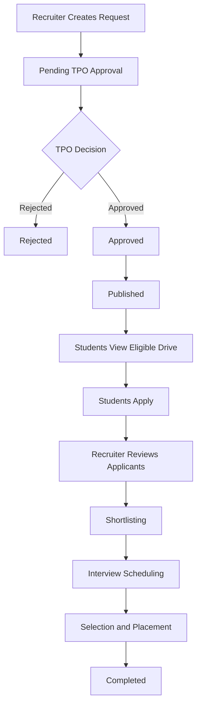
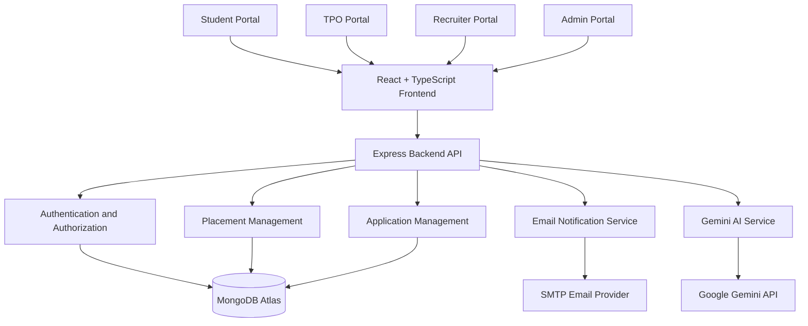

# PlaceMate AI
### AI-Powered Placement & Recruitment Management Agent

PlaceMate AI is an intelligent placement and recruitment management platform designed for VFSTR (Vignan University), Guntur, Andhra Pradesh.

The platform connects students, Training and Placement Officers (TPOs), recruiters, and administrators through a centralized system powered by Google's Gemini AI.

It aims to simplify campus placement operations, improve student employability, streamline recruitment workflows, and provide data-driven placement insights.

---

## Table of Contents

1. Project Overview
2. Objectives
3. Key Features
4. User Roles
5. Student Portal
6. TPO Portal
7. Recruiter Portal
8. Admin Portal
9. AI-Powered CV Generator
10. AI Resume ATS Analyzer
11. Gemini AI Integration
12. Placement Drive Management
13. Eligibility Management
14. Email Notification System
15. Application Management
16. Placement Analytics
17. UI/UX Design
18. Technology Stack
19. System Architecture
20. Project Structure
21. Database Design
22. Environment Variables
23. Installation and Setup
24. Running the Application
25. API Integration
26. Security
27. Real-Time Synchronization
28. Testing
29. Deployment
30. Future Enhancements
31. Contributing
32. License

---

# 1. Project Overview

PlaceMate AI is an AI-driven campus placement and recruitment management platform.

Traditional placement management systems often depend on manual processes for student eligibility verification, resume screening, company communication, placement drive coordination, and analytics.

PlaceMate AI addresses these challenges by integrating AI capabilities into the recruitment lifecycle.

The system provides:

- AI-powered resume generation
- Resume ATS analysis
- AI-based job recommendations
- Skill gap analysis
- AI mock interviews
- Placement drive management
- Student application tracking
- Recruiter dashboards
- TPO approval workflows
- Automated email notifications
- Placement analytics
- Centralized student and recruiter management

The application uses Gemini AI for genuine AI-generated responses and MongoDB for persistent data storage.

## 2. Objectives

The primary objectives are:

- Automate campus placement activities.
- Improve student placement readiness.
- Generate professional resumes using AI.
- Match students with suitable placement opportunities.
- Provide recruiters with a structured applicant management system.
- Allow TPOs to manage and approve placement drives.
- Maintain accurate, non-duplicated placement records.
- Provide real-time dashboards and placement statistics.
- Ensure secure, role-based access to the platform.

---

# 3. Key Features

| Feature | Description |
|---|---|
| AI CV Generator | Generates professional resumes using Gemini AI |
| ATS Resume Analyzer | Analyzes resumes and provides ATS-oriented feedback |
| AI Career Copilot | Answers career, coding, and placement-related questions |
| Skill Gap Analysis | Identifies missing skills for target roles |
| Job Recommendations | Recommends relevant opportunities |
| Mock Interviews | AI-powered interview practice |
| Student Dashboard | Personalized placement dashboard |
| TPO Dashboard | Placement management and analytics |
| Recruiter Dashboard | Company and recruitment management |
| Admin Dashboard | Platform administration |
| Placement Drives | Create, review, approve, and publish drives |
| Eligibility Management | Match students against drive criteria |
| Application Tracking | Track student applications |
| Email Notifications | Send placement announcements and updates |
| Analytics | Analyze placement activity and outcomes |
| Resume Downloads | Export resumes to PDF and DOCX |
| Theme Support | Light, Dark, and Cappuccino themes |

---

# 4. User Roles

PlaceMate AI supports four primary user roles.

## 4.1 Student

Students can:

- Log in using their university registration number.
- Manage their profile.
- Create and update resumes.
- Generate resumes using Gemini AI.
- Analyze resumes using ATS analysis.
- View eligible placement drives.
- Apply for placement opportunities.
- Track application status.
- Receive placement notifications.
- View skill gap recommendations.
- Practice AI mock interviews.
- Use the AI Career Copilot.

## 4.2 TPO (Training and Placement Officer)

TPO users can:

- View student placement information.
- Manage placement drives.
- Review recruiter requests.
- Approve or reject placement requests.
- Publish approved placement drives.
- Manage eligibility criteria.
- View student applications.
- Monitor placement activities.
- Send placement announcements.
- View placement analytics.
- Manage shortlisted student notifications.

## 4.3 Recruiter

Recruiters can:

- Register and manage company profiles.
- Submit campus placement requests.
- Create recruitment drive requests.
- Define job roles and eligibility criteria.
- View approved recruitment drives.
- Access applicants for their own drives.
- Review resumes.
- Shortlist candidates.
- Schedule interviews.
- Update candidate application statuses.
- Communicate with eligible candidates through authorized workflows.

Recruiters cannot directly publish placement drives without TPO approval.

## 4.4 Admin

Administrators can:

- Manage platform users.
- Manage authorized student records.
- Manage TPO and recruiter accounts.
- Monitor platform activities.
- Manage access permissions.
- Review system-level information.
- Maintain platform security.
- Manage configuration and integrations.

---

# 5. Student Portal

The Student Portal is the primary interface for students.

### Student Dashboard

The dashboard provides:

- Profile completion status
- Resume readiness
- Eligible placement drives
- Application statistics
- Upcoming interviews
- Recent placement notifications
- AI-powered career recommendations

### Student Profile

Student profiles may include:

- Registration number
- Full name
- Email address
- Phone number
- Branch
- Academic year
- CGPA
- Backlogs
- Technical skills
- Projects
- Certifications
- Internship experience
- Resume information

Student records must originate from authorized university data imports or approved administrative workflows.

The system must not create arbitrary student records through unrestricted registration.

---

# 6. TPO Portal

The TPO Portal provides centralized placement management.

### TPO Dashboard

The dashboard displays metrics derived from actual database records:

- Total active students
- Total registered recruiters
- Total placement drives
- Published drives
- Pending recruiter requests
- Total applications
- Shortlisted candidates
- Placed students
- Placement percentage
- Branch-wise placement statistics
- Company-wise recruitment statistics

### TPO Management Features

- Student roster management
- Recruiter request approval
- Placement drive management
- Eligibility management
- Application monitoring
- Email notifications
- Placement analytics
- Interview coordination

All statistics must be calculated from MongoDB records.

No hardcoded dashboard values or fake placement statistics should be used.

---

# 7. Recruiter Portal

The Recruiter Portal provides a company-specific recruitment interface.

### Company Profile

Recruiters can maintain:

- Company name
- Company description
- Industry
- Website
- Contact information
- HR details

### Recruitment Management

Recruiters can:

1. Submit a campus recruitment request.
2. Define the job role and requirements.
3. Specify eligibility criteria.
4. Submit the request for TPO approval.
5. Monitor approval status.
6. View applicants after the drive is published.
7. Shortlist candidates.
8. Schedule interviews.
9. Update recruitment statuses.

Recruiters must only access applicants associated with their own approved drives.

---

# 8. Admin Portal

The Admin Portal is responsible for system-level administration.

### Admin Capabilities

- User management
- Role management
- Student data management
- Recruiter account management
- TPO account management
- Access control
- System monitoring
- Database integrity management
- Security configuration

Only authorized administrators can perform sensitive administrative operations.

---

# 9. AI-Powered CV Generator

The CV Generator is one of the core AI features of PlaceMate AI.

It allows students to generate professional resumes using Gemini AI.

## Features

- AI-generated resume summaries
- AI-generated experience descriptions
- AI-generated project descriptions
- Skills organization
- Resume formatting
- Resume preview
- Live resume editing
- AI Career Copilot
- Dynamic suggested questions
- PDF export
- DOCX export

## CV Generator UI Behavior

The initial state must preserve the existing design:

- The chatbot occupies the main content area.
- The resume preview remains hidden initially.

When resume generation begins:

- The chatbot panel becomes smaller.
- The resume paper preview appears adjacent to the chatbot.
- Generated resume content is progressively displayed.
- The resume preview updates as content is generated.

The interface must not use fake streaming animations.

The typing indicator must reflect actual Gemini generation activity.

## Resume Content Rules

Gemini must:

- Generate professional resume content.
- Use only information provided by the student.
- Avoid inventing internships, achievements, projects, certifications, or work experience.
- Ask for missing information when necessary.
- Improve grammar and formatting.
- Create ATS-friendly content.

## Resume Links

The resume editor supports:

- GitHub
- LinkedIn
- Portfolio

Each link must be:

- Editable
- Removable
- Clickable
- Properly formatted in the exported resume

## Resume Downloads

The system supports:

- PDF download
- Word DOCX download

Downloads must be generated only after the resume generation process completes successfully.

The exported resume must use proper A4 formatting and preserve the resume structure and links.

---

# 10. AI Resume ATS Analyzer

The ATS Analyzer evaluates a student's resume against a target job description.

### Features

- Resume parsing
- Job description analysis
- ATS-oriented score
- Keyword matching
- Skill matching
- Missing keyword identification
- Resume improvement suggestions
- Summary optimization
- Experience description improvement

### Output

The analyzer should provide:

- Resume score
- Matched skills
- Missing skills
- Missing keywords
- Formatting recommendations
- Content recommendations
- Suggested resume improvements

ATS scores must be generated from actual resume and job-description analysis rather than fixed values.

---

# 11. Gemini AI Integration

PlaceMate AI integrates Google's Gemini AI API for intelligent content generation and conversational AI.

### AI Capabilities

Gemini is used for:

- CV generation
- Resume summaries
- Resume improvement suggestions
- ATS analysis
- Career Copilot responses
- Skill gap explanations
- Mock interview questions
- Interview feedback
- Job recommendations
- Career guidance

### Integration Requirements

- Use the official Google Gen AI SDK.
- Invoke Gemini from the backend.
- Read the API key from environment variables.
- Use a valid configured Gemini model.
- Send the actual user prompt to Gemini.
- Process the actual Gemini response.
- Return the generated response to the frontend.
- Handle API errors appropriately.
- Avoid mock responses and hardcoded AI content.

The application must not expose the Gemini API key in frontend code.

### AI Response Validation

The application should test the Gemini integration using questions such as:

```text
What is the sum of 2 + 3?
```

Expected response:

```text
5
```

Other verification prompts:

```text
What is the capital of India?
```

```text
Explain the difference between HTML and CSS.
```

```text
Generate a resume summary for a CSE student
with Python and HTML skills.
```

The application must return relevant answers from the configured Gemini API.

---

# 12. Placement Drive Management

Placement drives follow a controlled approval workflow.

## Drive Lifecycle



### Drive Information

Each drive may include:

- Company name
- Job role
- Job description
- Salary package
- Employment type
- Required skills
- Minimum CGPA
- Maximum backlogs
- Eligible branches
- Eligible graduation years
- Application deadline
- Interview dates
- Selection process
- Drive status

### Workflow Rules

- Recruiters submit placement requests.
- TPOs review and approve requests.
- Only approved drives can be published.
- Published drives become visible to eligible students.
- Students can apply only when eligible.
- Recruiters can access only their own applicants.
- Application status changes must be persisted.
- Notifications must be generated for relevant users.

---

# 13. Eligibility Management

The eligibility system determines whether students qualify for placement drives.

### Eligibility Criteria

- Branch
- CGPA
- Backlogs
- Graduation year
- Technical skills
- Other company-specific requirements

### Eligibility Workflow

1. Recruiter defines eligibility criteria.
2. TPO verifies the criteria.
3. System retrieves actual student records.
4. Eligibility is calculated.
5. Eligible students can view and apply.
6. Students receive relevant notifications.

Eligibility calculations must use actual student database records.

No fake student eligibility data should be generated.

---

# 14. Email Notification System

PlaceMate AI uses SMTP-based email notifications.

### Email Types

#### General TPO Announcements

Sent to all active students when the announcement is intended for the entire student population.

Examples:

- Placement training announcements
- General placement instructions
- Campus recruitment schedules

#### Company-Specific Placement Invitations

Sent only to eligible students for a particular placement drive.

#### Shortlisting Notifications

Sent only to shortlisted candidates.

#### Interview Notifications

Sent to the selected applicants who are scheduled for interviews.

### TPO Email Workflow

1. TPO selects the notification type.
2. Gemini may draft the email content.
3. TPO reviews the generated email.
4. TPO edits the email if necessary.
5. Backend determines the recipient list from actual database records.
6. TPO confirms sending.
7. Emails are sent individually.
8. Email delivery attempts are logged.

### Recipient Categories

- All active students
- Eligible students
- Selected branches
- Shortlisted students
- Individual students

### Email Logs

Email logs should include:

- Notification type
- Recipient
- Related placement drive
- Email status
- Sent timestamp
- Failure reason, if any

Statuses:

- Pending
- Sent
- Failed

The system should support retrying failed emails and prevent duplicate sends.

---

# 15. Application Management

Students can apply for published placement drives.

### Application Statuses

```text
Applied
Under Review
Shortlisted
Interview Scheduled
Selected
Rejected
Withdrawn
```

### Student Features

- Apply for placement drives.
- View application history.
- Track current application status.
- Receive status notifications.

### Recruiter Features

- View applicants for approved drives.
- Review applicant resumes.
- Shortlist applicants.
- Schedule interviews.
- Update candidate status.

### TPO Features

- Monitor application activity.
- View recruitment progress.
- Access placement analytics.
- Coordinate recruitment activities.

Application records must be stored in MongoDB.

---

# 16. Placement Analytics

The platform provides placement analytics for TPOs and authorized administrators.

### Analytics Metrics

- Total eligible students
- Total placed students
- Placement percentage
- Branch-wise placement
- Company-wise placement
- Average package
- Highest package
- Applications per drive
- Shortlisting rate
- Interview conversion rate
- Recruitment status distribution

### Data Integrity

Analytics must:

- Use actual database records.
- Avoid hardcoded statistics.
- Avoid duplicate placement counts.
- Respect academic and placement filters.
- Handle missing records appropriately.
- Display clear empty states when data is unavailable.

Historical placement information must be clearly distinguished from current live recruitment data.

---

# 17. UI/UX Design

PlaceMate AI follows a modern, professional, student-focused interface.

### Design Principles

- Clean layouts
- Responsive design
- Modern dashboards
- Consistent spacing
- Clear typography
- Accessible components
- Intuitive navigation
- Professional color palette

### Theme Support

The application supports:

- Light Theme
- Dark Theme
- Cappuccino Theme

Theme selection should be preserved using localStorage.

### Login Page

The login interface uses a split-screen design:

- Left side: Graduation-themed visual, branding, and project tagline.
- Right side: Authentication panel.

Supported login roles:

- Student
- TPO
- Recruiter
- Admin

### Authentication UI

- Show/hide password
- Forgot password
- Gmail OTP verification
- Login loading indicator
- Authentication error messages
- First-time permanent password setup

The existing finalized UI/UX must be preserved when modifying backend functionality.

---

# 18. Technology Stack

The application uses the following technologies.

| Technology | Purpose |
|---|---|
| React | Frontend user interface |
| TypeScript | Type-safe frontend development |
| Node.js | Backend runtime |
| Express.js | REST API framework |
| MongoDB Atlas | Cloud database |
| Mongoose | MongoDB object modeling |
| Google Gemini API | AI generation and analysis |
| Google Gen AI SDK | Gemini integration |
| JWT | Authentication |
| bcrypt | Password hashing |
| Nodemailer | SMTP email notifications |
| Socket.IO / Existing Real-Time Layer | Real-time updates, if configured |
| HTML5 | Structure |
| CSS3 | Styling |
| JavaScript | Application logic |
| Git | Version control |
| GitHub | Source code management |

The exact package versions should be taken from the project's package.json files.

---

# 19. System Architecture



### Architecture Principles

- Frontend communicates with backend APIs.
- Backend manages authentication and authorization.
- MongoDB stores application data.
- Gemini AI is accessed through the backend.
- SMTP is used for email notifications.
- All role-specific data access is validated by the backend.

---

# 20. Project Structure

The following is a suggested logical structure. The actual directory layout should be verified against the current repository.

```text
PlaceMate-AI/
│
├── client/
│   ├── public/
│   ├── src/
│   │   ├── assets/
│   │   ├── components/
│   │   ├── pages/
│   │   │   ├── Student/
│   │   │   ├── TPO/
│   │   │   ├── Recruiter/
│   │   │   └── Admin/
│   │   ├── features/
│   │   │   ├── CVGenerator/
│   │   │   ├── ATSAnalyzer/
│   │   │   ├── CareerCopilot/
│   │   │   └── MockInterview/
│   │   ├── services/
│   │   ├── hooks/
│   │   ├── contexts/
│   │   ├── types/
│   │   ├── utils/
│   │   └── App.tsx
│   │
│   └── package.json
│
├── server/
│   ├── config/
│   ├── controllers/
│   ├── models/
│   ├── routes/
│   ├── middleware/
│   ├── services/
│   │   ├── geminiService.ts
│   │   ├── emailService.ts
│   │   └── placementService.ts
│   ├── utils/
│   ├── app.ts
│   ├── server.ts
│   └── package.json
│
├── .env
├── .env.example
├── .gitignore
├── README.md
└── package.json
```

---

# 21. Database Design

PlaceMate AI uses MongoDB Atlas.

### Main Collections

| Collection | Purpose |
|---|---|
| users | Authentication and user role information |
| students | Student academic and profile information |
| recruiters | Company and recruiter profiles |
| tpos | TPO account information |
| placementDrives | Placement drive information |
| applications | Student placement applications |
| resumes | Student resume information |
| notifications | In-app notifications |
| emailLogs | Email delivery records |
| interviews | Interview scheduling |
| placements | Final placement records |

These are logical collection names. The exact collection names and schemas must match the implemented application.

### Data Integrity Requirements

- Database starts empty except for the securely provisioned admin account.
- No fake students or companies are pre-seeded.
- Student data is populated through authorized university imports.
- Duplicate student records must be prevented.
- Registration numbers must be unique.
- Recruiter records must be validated.
- Placement drives must have unique identifiers.
- Application records must prevent duplicate applications to the same drive.
- Historical placement data must be preserved.

---

# 22. Environment Variables

Create a `.env` file in the backend root directory.

```env
# Server Configuration
PORT=5000
NODE_ENV=development

# MongoDB Atlas
MONGODB_URI=your_mongodb_connection_string

# Gemini AI
GEMINI_API_KEY=your_gemini_api_key
GEMINI_MODEL=your_supported_gemini_model

# Authentication
JWT_SECRET=your_secure_random_jwt_secret
JWT_EXPIRES_IN=1d

# SMTP Email Configuration
SMTP_HOST=smtp.gmail.com
SMTP_PORT=587
SMTP_SECURE=false
SMTP_USER=your_gmail_address
SMTP_PASS=your_gmail_app_password

# Frontend URL
CLIENT_URL=http://localhost:5173
```

### Environment Configuration Notes

- Never commit `.env` to GitHub.
- Use a secure MongoDB connection string.
- Use a Gemini API key from Google AI Studio.
- Use a Gmail App Password for SMTP.
- Do not use a regular Gmail account password for SMTP.
- Generate a strong JWT secret.
- Keep all secret values on the backend.
- Use separate environment variables for development and production.

### `.gitignore`

```gitignore
node_modules/
.env
.env.local
.env.production
dist/
build/
coverage/
.DS_Store
```

### `.env.example`

The `.env.example` file should contain placeholders only.

```env
PORT=5000
NODE_ENV=development
MONGODB_URI=
GEMINI_API_KEY=
GEMINI_MODEL=
JWT_SECRET=
JWT_EXPIRES_IN=1d
SMTP_HOST=smtp.gmail.com
SMTP_PORT=587
SMTP_SECURE=false
SMTP_USER=
SMTP_PASS=
CLIENT_URL=http://localhost:5173
```

---

# 23. Installation and Setup

## Prerequisites

Install the following:

- Node.js
- npm
- Git
- MongoDB Atlas account
- Google AI Studio API key
- Gmail account with App Password enabled

## Clone the Repository

```bash
git clone YOUR_GITHUB_REPOSITORY_URL
```

```bash
cd PlaceMate-AI
```

## Install Dependencies

If the project uses separate frontend and backend directories:

### Frontend

```bash
cd client
npm install
```

### Backend

```bash
cd ../server
npm install
```

Configure the backend `.env` file before running the application.

---

# 24. Running the Application

## Start the Backend

```bash
cd server
npm run dev
```

The backend should run on:

```text
http://localhost:5000
```

## Start the Frontend

```bash
cd client
npm run dev
```

The frontend should run on:

```text
http://localhost:5173
```

These ports are configurable.

### Production Build

Frontend:

```bash
npm run build
```

Backend:

```bash
npm start
```

Use the actual scripts defined in the project's package.json files.

---

# 25. API Integration

The backend exposes REST APIs for authentication, placement management, resume generation, and recruitment operations.

The following endpoints are logical examples. They must be aligned with the actual implemented API routes.

## Authentication

| Method | Endpoint | Description |
|---|---|---|
| POST | /api/auth/login | Login |
| POST | /api/auth/logout | Logout |
| POST | /api/auth/forgot-password | Initiate password recovery |
| POST | /api/auth/verify-otp | Verify OTP |
| POST | /api/auth/reset-password | Reset password |

## Student

| Method | Endpoint | Description |
|---|---|---|
| GET | /api/students/profile | Get student profile |
| PUT | /api/students/profile | Update profile |
| GET | /api/students/drives | View eligible placement drives |
| POST | /api/students/applications | Apply for a drive |
| GET | /api/students/applications | View applications |

## CV Generator

| Method | Endpoint | Description |
|---|---|---|
| POST | /api/resume/generate | Generate resume using Gemini |
| POST | /api/resume/analyze | Analyze resume |
| PUT | /api/resume/:id | Update resume |
| GET | /api/resume/:id | Retrieve resume |
| GET | /api/resume/:id/pdf | Export PDF |
| GET | /api/resume/:id/docx | Export DOCX |

## TPO

| Method | Endpoint | Description |
|---|---|---|
| GET | /api/tpo/dashboard | TPO dashboard |
| GET | /api/tpo/drives | View placement drives |
| POST | /api/tpo/drives/:id/approve | Approve drive |
| POST | /api/tpo/drives/:id/reject | Reject drive |
| POST | /api/tpo/drives/:id/publish | Publish drive |
| GET | /api/tpo/analytics | Placement analytics |
| POST | /api/tpo/notifications/email | Send email notification |

## Recruiter

| Method | Endpoint | Description |
|---|---|---|
| GET | /api/recruiter/profile | Get company profile |
| PUT | /api/recruiter/profile | Update company profile |
| POST | /api/recruiter/drives | Submit placement request |
| GET | /api/recruiter/drives | View recruiter drives |
| GET | /api/recruiter/applicants/:driveId | View applicants |
| POST | /api/recruiter/applicants/:id/shortlist | Shortlist applicant |
| POST | /api/recruiter/interviews | Schedule interview |

## Admin

| Method | Endpoint | Description |
|---|---|---|
| GET | /api/admin/dashboard | Admin dashboard |
| GET | /api/admin/users | Manage users |
| POST | /api/admin/students/import | Import student records |
| PUT | /api/admin/users/:id | Update user |
| DELETE | /api/admin/users/:id | Remove authorized user |

---

# 26. Security

PlaceMate AI must follow secure development practices.

### Authentication

- JWT-based authentication.
- Secure password hashing using bcrypt.
- Protected routes.
- First-time permanent password setup.
- Verified email OTP for password recovery.

### Authorization

- Role-based access control.
- Student data restricted to authorized users.
- Recruiter data restricted to the recruiter's company.
- TPO permissions restricted to placement management.
- Admin actions restricted to authorized administrators.

### API Security

- Validate request bodies.
- Sanitize user input.
- Protect against unauthorized database access.
- Implement rate limiting.
- Handle errors securely.
- Avoid exposing secrets in API responses.
- Avoid exposing internal stack traces in production.

### AI Security

- Gemini API key stored in backend environment variables.
- Validate AI-generated outputs.
- Avoid sending unnecessary sensitive information to AI providers.
- Prevent prompt injection from being treated as application authorization.
- Verify permissions before returning AI-generated or database-derived information.

---

# 27. Real-Time Synchronization

The platform should provide real-time or near-real-time updates for placement activities.

### Real-Time Events

- New placement drive published
- Application submitted
- Application shortlisted
- Interview scheduled
- Placement drive approved
- Placement drive rejected
- New TPO announcement
- Recruiter application status update

### Implementation

Use the project's existing real-time architecture.

If Socket.IO is already configured, use it for real-time event delivery.

If real-time infrastructure is unavailable, use controlled API polling.

All updates must originate from actual backend events or database records.

---

# 28. Testing

The application should be tested end-to-end.

## Authentication Tests

- Student login
- TPO login
- Recruiter login
- Admin login
- Invalid password
- Unauthorized access
- Password recovery
- OTP verification

## Gemini AI Tests

- General question answering
- Mathematical question answering
- Resume generation
- Resume summary generation
- ATS analysis
- AI mock interview
- Gemini API failure handling
- Missing API key handling

Example:

```text
Question: What is the sum of 2 + 3?
Expected: 5
```

## Placement Tests

- Recruiter submits placement request.
- TPO approves request.
- TPO publishes drive.
- Eligible students view drive.
- Student applies.
- Recruiter views applicants.
- Recruiter shortlists candidate.
- Interview is scheduled.
- Student receives notification.

## Email Tests

- General TPO announcement.
- Eligible student invitation.
- Shortlisting notification.
- Interview notification.
- SMTP failure handling.
- Duplicate email prevention.

## Data Integrity Tests

- Duplicate registration number prevention.
- Duplicate application prevention.
- Empty database dashboard.
- Real placement analytics.
- No fake data generation.
- Authorized student import.

---

# 29. Deployment

PlaceMate AI can be deployed using cloud hosting platforms.

### Deployment Components

| Component | Deployment |
|---|---|
| Frontend | Static hosting or frontend hosting platform |
| Backend | Node.js hosting platform |
| Database | MongoDB Atlas |
| AI | Google Gemini API |
| Email | Gmail SMTP or another authorized SMTP provider |

### Deployment Requirements

- Configure production environment variables.
- Configure MongoDB Atlas network access.
- Configure frontend and backend URLs.
- Enable HTTPS.
- Configure CORS.
- Keep secrets out of frontend bundles.
- Use production JWT secrets.
- Configure SMTP credentials.
- Test authentication and AI generation in production.
- Verify PDF and DOCX exports.

### Production Environment Variables

Set all required environment variables using the deployment platform's secure environment configuration.

Do not upload `.env` files to public repositories.

---

# 30. Future Enhancements

Potential future enhancements include:

- AI-based placement prediction
- Advanced career path recommendations
- Enhanced ATS scoring
- Company recruitment trend analytics
- Resume version management
- Advanced interview preparation
- Placement readiness scoring
- University LMS integration
- Automated placement reports
- Branch-specific recruitment analytics
- Enhanced notification management
- Advanced student skill tracking

---

# 31. Contributing

Contributions to PlaceMate AI are welcome.

### Contribution Guidelines

1. Fork the repository.
2. Create a feature branch.
3. Implement the feature.
4. Test the changes.
5. Commit the changes.
6. Submit a pull request.

### Development Principles

- Preserve the finalized UI/UX.
- Avoid breaking existing functionality.
- Use actual Gemini API responses.
- Avoid hardcoded database data.
- Maintain secure authentication.
- Follow existing project conventions.
- Ensure new features are tested.

---

# 32. License

This project is developed for academic and educational purposes.

A formal license should be added according to the project's ownership and distribution requirements.

---

# Project Information

**Project Name:** PlaceMate AI

**Project Category:** AI-Powered Placement & Recruitment Management System

**Institution:** VFSTR (Vignan University), Guntur, Andhra Pradesh

**AI Integration:** Google Gemini API

**Database:** MongoDB Atlas

**Frontend:** React + TypeScript

**Backend:** Node.js + Express.js

**Primary Goal:** To enhance campus placement management through artificial intelligence, automation, and data-driven recruitment workflows.

---

## Important Data Integrity Principle

PlaceMate AI is designed to use genuine and verified information.

- Student data must come from authorized university records.
- Placement drive information must be verified by TPOs.
- Recruiter information must be validated.
- Placement statistics must be calculated from actual database records.
- AI-generated content must come from the configured Gemini API.
- Historical recruitment data must not be represented as current live placement information.
- No fake student, recruiter, company, or placement records should be created.

The platform's primary goal is to provide a reliable, secure, and intelligent campus placement management experience.
